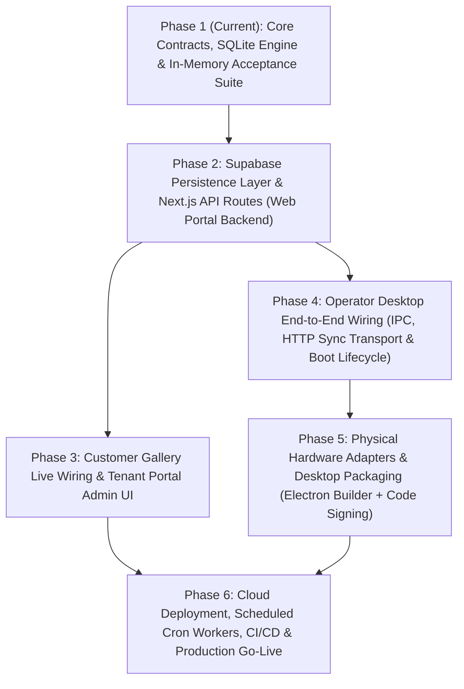

# ODC-PhotoStudio — System Phase Assessment & Production Deployment Roadmap

## 1. Current System Phase Assessment

**Current Maturity Level:** **Phase 1 Complete — Core Domain, Local Persistence & Simulation Verified (`v0.1.0`)**

All TypeScript workspaces pass `pnpm typecheck` and all 14 acceptance tests (**A01–A23**, including the 500-session stress simulation) pass via `pnpm test`. However, the system is currently an **in-process / mock-backed reference implementation** rather than a cloud-connected, hardware-bound, packaged production release.

### 1.1 Component Readiness Matrix

| Subsystem | Location | Status | What Exists Now | What Is Missing for Deployment |
| :--- | :--- | :--- | :--- | :--- |
| **Contracts & State Machines** | [`packages/contracts`](file:///g:/Projects/ODC-PhotoStudio/packages/contracts/src/index.ts) | **Production Ready (95%)** | Zod schemas, 5 state tracks (`capture`, `composite`, `print`, `upload`, `deletion`), SHA-256 token hashing, Ed25519 grant signing/verification, redaction utilities. | Production key rotation support (`kid` header / multi-key verification) for zero-downtime Ed25519 grant key rollover. |
| **Template & Compositor Engine** | [`packages/template-engine`](file:///g:/Projects/ODC-PhotoStudio/packages/template-engine/src/index.ts) | **Production Ready (95%)** | Deterministic `CLIP_BEFORE_ROTATION_AROUND_SLOT_CENTER` geometry, Sharp sRGB compositor, EXIF stripping, 4-module quiet zone QR generator, 2×6-on-4×6 print imposition. | Font/asset bundling verification inside packaged Electron `asar` / serverless environments. |
| **Database Schema & RLS** | [`20261018000001_initial_schema_and_rls.sql`](file:///g:/Projects/ODC-PhotoStudio/supabase/migrations/20261018000001_initial_schema_and_rls.sql) | **Schema Ready / Unapplied (75%)** | 13 tables, composite same-tenant foreign keys, RLS enabled on all tables, `app_internal` security-definer helpers. | Missing `token_tombstones` table (currently only in memory in `CloudPortalService`), missing INSERT/UPDATE/DELETE RLS policies for `stations`, `layout_templates`, `template_versions`, `event_assignments`, `session_assets`, and Supabase Storage bucket policies (`private-media`, `template-overlays`). |
| **Web Portal & Cloud API** | [`apps/web-portal`](file:///g:/Projects/ODC-PhotoStudio/apps/web-portal/src/lib/cloud-service.ts) | **In-Memory Prototype (35%)** | [`CloudPortalService`](file:///g:/Projects/ODC-PhotoStudio/apps/web-portal/src/lib/cloud-service.ts#L119-L958) implements all domain rules using in-memory `Map` stores. [`page.tsx`](file:///g:/Projects/ODC-PhotoStudio/apps/web-portal/src/app/page.tsx) and [`g/[token]/page.tsx`](file:///g:/Projects/ODC-PhotoStudio/apps/web-portal/src/app/g/%5Btoken%5D/page.tsx) are static/local UI shells. | Zero Next.js Route Handlers (`src/app/api/v1/...`) exist yet; `CloudPortalService` must be backed by Supabase PostgreSQL & Storage; Customer Gallery page needs real `fetch()` integration; Tenant Portal needs Auth + CRUD UI; Cron worker endpoint needed for 5-minute deletion sweeps. |
| **Operator Desktop Console** | [`apps/operator-desktop`](file:///g:/Projects/ODC-PhotoStudio/apps/operator-desktop/src/main/orchestrator.ts) | **Local Core Built / IPC Disconnected (55%)** | [`StationDatabase`](file:///g:/Projects/ODC-PhotoStudio/apps/operator-desktop/src/main/db.ts), [`StationOrchestrator`](file:///g:/Projects/ODC-PhotoStudio/apps/operator-desktop/src/main/orchestrator.ts), and [`DurableSyncEngine`](file:///g:/Projects/ODC-PhotoStudio/apps/operator-desktop/src/main/queue/sync-engine.ts) are implemented and tested. | [`store.ts`](file:///g:/Projects/ODC-PhotoStudio/apps/operator-desktop/src/renderer/store.ts#L69-L270) mutates local mock state in memory instead of calling `window.odcOperatorBridge`; [`main/index.ts`](file:///g:/Projects/ODC-PhotoStudio/apps/operator-desktop/src/main/index.ts#L126-L132) does not instantiate `StationOrchestrator`, `createOperatorWindow`, or a background sync loop on `app.whenReady()`; no HTTP `CloudSyncTransport` implementation; no `electron-builder` installer config. |
| **Hardware Providers (Camera & Printer)** | [`camera/provider.ts`](file:///g:/Projects/ODC-PhotoStudio/apps/operator-desktop/src/main/camera/provider.ts), [`printer/provider.ts`](file:///g:/Projects/ODC-PhotoStudio/apps/operator-desktop/src/main/printer/provider.ts) | **Mock Only (25%)** | `MockCameraProvider` and `MockPrinterProvider` work deterministically. [`UnqualifiedRealCameraProvider`](file:///g:/Projects/ODC-PhotoStudio/apps/operator-desktop/src/main/camera/provider.ts#L235-L259) throws `HARDWARE_UNQUALIFIED`. | Real DSLR tethering adapter (Canon EDSDK / Nikon MAID / gPhoto2 / CameraControlCmd) and Windows Spooler / Win32 print adapter (`IPrinterProvider` real implementation) + physical qualification. |

---

## 2. Production Deployment Roadmap Overview

---

## 3. Detailed Phase-by-Phase Execution Plan

### Phase 2: Supabase Persistence Layer & Next.js API Routes (`apps/web-portal`)
**Objective:** Replace the in-memory `Map` storage inside [`CloudPortalService`](file:///g:/Projects/ODC-PhotoStudio/apps/web-portal/src/lib/cloud-service.ts#L119-L132) with persistent Supabase PostgreSQL + Supabase Storage queries and expose versioned HTTP endpoints (`/api/v1/*`).

1. **Complete Supabase Schema & Storage Migrations (`supabase/migrations/`)**
   - Add a second migration `20261019000002_storage_buckets_tombstones_and_rls.sql`:
     - Create `public.token_tombstones` (`token_hash text primary key`, `expires_at timestamptz`, `retain_until timestamptz`) to persist the 7-day post-deletion expiration notice window across serverless cold starts.
     - Configure private Supabase Storage buckets: `session-media` (private) and `template-overlays` (private/authenticated).
     - Complete explicit `SELECT`/`INSERT`/`UPDATE`/`DELETE` RLS policies for `stations`, `event_assignments`, `layout_templates`, `template_versions`, `event_templates`, `session_assets`, `deletion_jobs`, and `audit_events`.
2. **Implement `SupabaseCloudPortalRepository` (`apps/web-portal/src/lib/supabase-repository.ts`)**
   - Create server-side Supabase client factories (`createServiceRoleClient()` for token lookups, session ingestion, and storage sweeps; `createAuthenticatedServerClient()` for tenant portal RBAC).
   - Port `CloudPortalService` methods (`issueOfflineEventGrant`, `registerSession`, `uploadSessionAssetObject`, `finalizeSessionPublication`, `lookupGalleryByToken`, `authorizeGuestAssetDownload`, `runScheduledDeletionSweep`, `requestEarlyDeletion`) to use PostgreSQL transactions/RPCs and Supabase Storage signed upload/download URLs while keeping the in-memory adapter for fast unit tests.
3. **Create Next.js App Router API Endpoints (`apps/web-portal/src/app/api/v1/`)**
   - `POST /api/v1/station/prepare-grant`: Authenticates operator/admin, validates station assignment, and returns `SignedOfflineGrant` + event configuration + template overlay URLs + `serverTimeIso`.
   - `POST /api/v1/sessions/register`: Validates operator token, checks live membership & clock drift, upserts `photo_sessions`, and returns `alreadyUploadedAssetIds`.
   - `PUT /api/v1/sessions/[sessionId]/assets/[assetId]`: Verifies SHA-256 checksum, enforces immutable object check, and writes to Supabase Storage (`{tenant_id}/{event_id}/{session_id}/{asset_id}.jpg`).
   - `POST /api/v1/sessions/[sessionId]/finalize`: Verifies all manifest assets in storage and marks `upload_state = 'published'`.
   - `GET /api/v1/gallery/[token]`: Hashes bearer token with `TOKEN_PEPPER_SECRET`, enforces immediate `expires_at` cutoff, and returns `GalleryLookupResponse`.
   - `GET /api/v1/gallery/[token]/download`: Generates a capped (`<= 60s`, never exceeding `expires_at`) signed Supabase Storage download URL or streams the asset with `Content-Disposition: attachment`.
   - `POST /api/v1/internal/cron/deletion-sweep`: Protected by `Authorization: Bearer ${CRON_WORKER_SECRET}`; runs `runScheduledDeletionSweep()` every 5 minutes and emits overdue deletion alerts (`>15 min` past expiration).

**Deliverable / Exit Gate:** All `/api/v1/*` route handlers pass integration tests against a local Supabase instance (`supabase start`).

---

### Phase 3: Customer Gallery Live Wiring & Tenant Portal Admin UI (`apps/web-portal`)
**Objective:** Turn the static Next.js pages into functional production interfaces connected to Supabase Auth and `/api/v1/*`.

1. **Wire Customer Gallery (`apps/web-portal/src/app/g/[token]/page.tsx`)**
   - Replace static initial state in [`CustomerGalleryPage`](file:///g:/Projects/ODC-PhotoStudio/apps/web-portal/src/app/g/%5Btoken%5D/page.tsx#L21-L55) with real `fetch('/api/v1/gallery/' + encodeURIComponent(token))` on mount and on each bounded poll tick (`5s` for first `30s`, `30s` up to `10m`, paused when `document.hidden`).
   - Render authenticated image previews and wire the Download button to `/api/v1/gallery/[token]/download?assetId=...`.
2. **Build Tenant Portal Auth & Management Views (`apps/web-portal/src/app/`)**
   - Add `/login` page using `@supabase/ssr` / `@supabase/supabase-js` authentication and explicit tenant switcher (no ambient default tenant).
   - Build interactive management views replacing the static cards in [`page.tsx`](file:///g:/Projects/ODC-PhotoStudio/apps/web-portal/src/app/page.tsx):
     - **Events & Station Assignments**: Create events, assign operators/stations, and generate/download offline station packages.
     - **Template Studio**: Upload 300 DPI PNG overlays (`1200×1800` or `600×1800`), define slot geometry (`fit`, `focalPoint`, `rotationDeg`) and reserved QR region with live preview using `@odc-photostudio/template-engine`, and publish immutable `template_versions`.
     - **Staff & Stations**: Invite/revoke operators (`owner`, `admin`, `operator`) and register/revoke station UUIDs.
     - **Session Audit & Privacy Control**: View session sync statuses for active events and trigger **Early Deletion** (`requestEarlyDeletion`).

**Deliverable / Exit Gate:** End-to-end browser verification of tenant login, template creation, event creation, and guest QR gallery download/expiration flow.

---

### Phase 4: Operator Desktop End-to-End Wiring (`apps/operator-desktop`)
**Objective:** Connect the Electron renderer, preload bridge, main process orchestrator, background worker, and HTTP cloud sync transport into a runnable desktop application.

1. **Complete Main Process Lifecycle Boot (`apps/operator-desktop/src/main/index.ts`)**
   - In [`src/main/index.ts`](file:///g:/Projects/ODC-PhotoStudio/apps/operator-desktop/src/main/index.ts#L126-L132), wire `app.whenReady()` to:
     - Initialize `CameraProvider` and `PrinterProvider` based on `ODC_DESKTOP_MODE` (`mock` vs `real`).
     - Instantiate [`StationOrchestrator`](file:///g:/Projects/ODC-PhotoStudio/apps/operator-desktop/src/main/orchestrator.ts#L62-L98) with `ODC_DATA_DIR`, `ODC_STATION_ID`, and `OFFLINE_GRANT_PUBLIC_KEY_PEM`.
     - Run `orchestrator.syncEngine.runStartupReconciliation()` before opening the window.
     - Register all IPC handlers (`registerValidatedIpcHandlers(orchestrator)`) plus additional IPC handlers for live-view frame streaming, sync queue status inspection, event offline preparation, and operator re-authentication.
     - Launch `createOperatorWindow()` pointing to Vite dev server in development or packaged `dist/renderer/index.html` in production.
2. **Implement HTTP `CloudSyncTransport` (`apps/operator-desktop/src/main/queue/http-transport.ts`)**
   - Implement [`CloudSyncTransport`](file:///g:/Projects/ODC-PhotoStudio/apps/operator-desktop/src/main/queue/sync-engine.ts#L13-L48) using `fetch` against `ODC_PORTAL_API_URL/api/v1/sessions/*` with operator bearer JWT authentication and request timeouts.
   - Start a background interval loop in the main process that calls `syncEngine.processNextPendingJob(httpTransport, { clockHealthy })` every 3 seconds when online and runs local retention cleanup every 5 minutes.
3. **Connect Renderer Zustand Store to Preload IPC (`apps/operator-desktop/src/renderer/store.ts`)**
   - Update [`useOperatorStore`](file:///g:/Projects/ODC-PhotoStudio/apps/operator-desktop/src/renderer/store.ts#L69-L270) so `triggerCaptureOrRetake`, `approveSession`, `submitPrint`, `resolveUnknownPrint`, and `startNextSession` invoke `window.odcOperatorBridge.*` IPC methods instead of generating fake in-memory SVG strings, falling back to browser preview mode only when running outside Electron.
   - Render real captured frame thumbnails (`file://` or safe custom protocol `odc-media://` registered in Electron `protocol.handle`) and live-view JPEG frames on `<canvas>`.

**Deliverable / Exit Gate:** Running `pnpm dev:desktop` alongside `pnpm dev:web` captures photos locally in SQLite, composites with Sharp, outputs mock print imposition files, uploads to the local web portal in the background, and serves the published photos at the QR code URL `/g/[token]`.

---

### Phase 5: Hardware Qualification & Desktop Installer Packaging (`apps/operator-desktop`)
**Objective:** Implement physical camera/printer drivers and package the Windows x64 operator installer.

1. **Physical Printer Integration (`apps/operator-desktop/src/main/printer/windows-spooler-provider.ts`)**
   - Implement `WindowsSpoolerPrinterProvider implements IPrinterProvider` using Windows print spooler APIs / PowerShell `System.Drawing.Printing` or native Win32 spooler binding to enumerate installed printers (e.g., DNP DS620A, HiTi, Citizen) and submit 300 DPI 4×6 / 2×6 imposed buffers with exact 1:1 scaling.
2. **Physical Camera Integration (`apps/operator-desktop/src/main/camera/real-camera-provider.ts`)**
   - Replace [`UnqualifiedRealCameraProvider`](file:///g:/Projects/ODC-PhotoStudio/apps/operator-desktop/src/main/camera/provider.ts#L235-L259) with a worker-isolated adapter for the target DSLR SDK (e.g., Canon EDSDK / digiCamControl CLI / gPhoto2 bridge), supporting USB live view, shutter release to staging file, and USB disconnect detection.
   - Execute the physical hardware qualification checklist in [`docs/hardware-and-operations-runbook.md`](file:///g:/Projects/ODC-PhotoStudio/docs/hardware-and-operations-runbook.md#L1-L19).
3. **Electron Packaging & Native Module Bundling (`apps/operator-desktop/electron-builder.yml`)**
   - Add `electron-builder` configuration for Windows x64 NSIS installer.
   - Configure `asarUnpack` for `sharp` and `@img/sharp-win32-x64` native binaries.
   - Verify build-time secret guard: ensure `SUPABASE_SERVICE_ROLE_KEY`, `OFFLINE_GRANT_PRIVATE_KEY_PEM`, and `TOKEN_PEPPER_SECRET` are **never** bundled into the desktop binary.

**Deliverable / Exit Gate:** Signed Windows `.exe` installer runs on a clean Windows 10/11 x64 station without Node/pnpm pre-installed.

---

### Phase 6: Cloud Infrastructure, CI/CD & Production Launch
**Objective:** Deploy the multi-tenant cloud stack, automate testing/releases, and verify operational SLAs.

1. **Production Cryptography & Environment Provisioning**
   - Generate production Ed25519 keypair (`generateEd25519GrantKeyPair()`); store `OFFLINE_GRANT_PRIVATE_KEY_PEM` in cloud secret manager and embed `OFFLINE_GRANT_PUBLIC_KEY_PEM` in desktop/web configs.
   - Generate 32-byte random `TOKEN_PEPPER_SECRET` and `CRON_WORKER_SECRET`.
2. **Supabase Production Setup**
   - Apply migrations via `supabase db push`.
   - Verify RLS policies with automated negative security tests (`A12`, `A13`).
3. **Web Portal Deployment & Scheduled Cron**
   - Deploy `apps/web-portal` to Vercel / Cloudflare / containerized Node.js host with custom domain (`NEXT_PUBLIC_GALLERY_ORIGIN`).
   - Configure a 5-minute cron schedule (`*/5 * * * *` via Vercel Cron, Supabase `pg_cron`, or GitHub Actions/Cloudflare Cron) hitting `POST /api/v1/internal/cron/deletion-sweep`.
   - Wire webhook/alerting when `overdueAlertSessionIds.length > 0` (15-minute post-expiration deletion SLA breach).
4. **CI/CD Pipeline (`.github/workflows/ci.yml`)**
   - Run `pnpm typecheck`, `pnpm test` (A01–A23 acceptance suite), secret-leak check on desktop bundle, and `pnpm build` on every PR and main branch push.

---

## 4. Recommended Implementation Sequence & Effort Estimate

| Order | Milestone | Key Files Affected | Target Outcome |
| :---: | :--- | :--- | :--- |
| **1** | **Supabase DB & Storage Adapter + Next.js API Routes** | `supabase/migrations/*`, `apps/web-portal/src/lib/cloud-service.ts`, `apps/web-portal/src/app/api/v1/**` | Cloud endpoints live and persisted in Postgres/Storage |
| **2** | **Operator Desktop Main/Preload/Renderer Wiring + HTTP Sync** | `apps/operator-desktop/src/main/index.ts`, `apps/operator-desktop/src/renderer/store.ts`, `apps/operator-desktop/src/main/queue/sync-engine.ts` | Desktop app runs end-to-end in Mock Mode and syncs to Web Portal |
| **3** | **Customer Gallery Live Polling & Download Flow** | `apps/web-portal/src/app/g/[token]/page.tsx` | Scanning a printed QR code loads and downloads real composite & shots |
| **4** | **Tenant Portal Auth, Event Prep & Template Studio UI** | `apps/web-portal/src/app/page.tsx`, `apps/web-portal/src/app/login/**` | Studio owners can manage events, templates, and offline grants in browser |
| **5** | **Electron Packaging (`electron-builder`) & CI/CD** | `apps/operator-desktop/package.json`, `.github/workflows/ci.yml` | Distributable Windows installer and automated regression gates |
| **6** | **Physical Camera & Printer Drivers + Hardware Qualification** | `apps/operator-desktop/src/main/camera/*`, `apps/operator-desktop/src/main/printer/*` | Certified for live events with physical DSLR and dye-sub printer |
