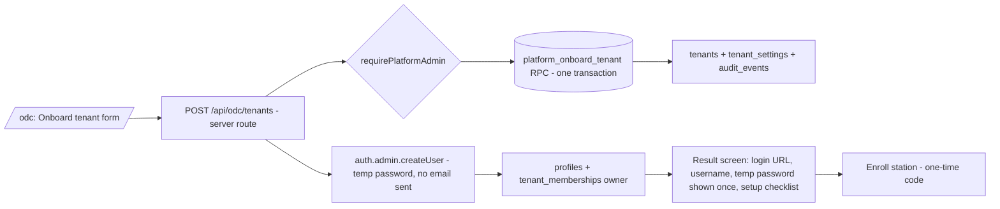

# `/odc` Super-Admin & Client Onboarding Plan for ODC-PhotoStudio

**Status:** Revised proposal · **Reference studied:** `Multi-Tenant-Pickleball-Court-Booking-System-Prod` (*Pickleball*) · **Target:** this repo (`apps/web-portal`, `supabase/`, `apps/operator-desktop`)

**Scope decisions (from review):**
- **Onboarding is the priority.** Everything else on `/odc` is deferred (see §7 Backlog).
- **Hosting: Cloudflare** (see §5).
- **No emailer yet.** No real email accounts and no invites; the platform admin creates the owner login and hands over a one-time temporary password.
- **Tiers:** Basic (free), Plus (999), Business (1999). See §3.
- **MFA:** not yet (backlog). **Leads form:** backlog.

---

## 1. How Pickleball onboards a client (reference)

On the hidden `/odc` dashboard, "Onboard client" opens a modal (name → auto slug/id, business type, tier, billing status, owner email + password). On submit the **browser** runs five sequential calls:

| # | Step | Table / API |
|---|------|-------------|
| 1 | Check `id`/`slug` unique | `tenants` |
| 2 | Insert tenant with feature flags derived from tier/business type | `tenants` |
| 3 | Insert default branding/settings | `tenant_settings` |
| 4 | Create owner login (`auth.signUp` on a throw-away client) | `auth.users` |
| 5 | Link user as `owner` | `admin_users` |

A success screen shows the credentials and a generated `.env` block.

`/odc` itself is guarded by `is_superadmin` (non-admins get `/404`), and offers KPIs, per-tenant feature toggles, billing, suspend/reactivate, leads, and payment verification. Tenants are resolved per domain via a Cloudflare KV lookup.

### Weaknesses not to copy

| Reference problem | Our approach |
|---|---|
| 5 non-atomic client-side calls → orphan rows on failure | One server route + one Postgres function (transaction); delete the auth user if a later step fails |
| Superadmin = hardcoded email auto-provisioned in the guard | Dedicated `platform_admins` table checked in RLS/RPC and server routes |
| Password shown/copied in plain text, chosen by operator | Server-generated temp password, **shown once**, forced change on first login, never logged |
| Secrets (Turnstile) hardcoded in middleware | Secrets only in Cloudflare env/secrets |
| Flags duplicated across DB, `VITE_FEAT_*`, config | Single source: `tenants.plan` + `tenants.features`/`limits` |
| Per-client `.env` build hand-off | Runtime config from DB; no per-client build |

---

## 2. Target onboarding flow



### Form fields
Studio name (→ slug, editable, validated `^[a-z0-9-]+$`, unique) · **Plan** (Basic / Plus / Business) · Owner display name · Owner login ID (see below) · optional contact phone / notes.

### Server steps (service-role key, server only)
1. Verify caller is a platform admin (`requirePlatformAdmin()`), validate input with zod (shared in `packages/contracts`).
2. Generate a random 16+ char temp password server-side.
3. `auth.admin.createUser({ email: loginId, password, email_confirm: true, app_metadata: { must_change_password: true } })`. **No email is sent.**
4. Call `platform_onboard_tenant(...)`: inserts `tenants` (status `active`, `plan`, `features` + `limits` from the plan catalogue), `tenant_settings`, `profiles`, `tenant_memberships(role='owner', status='active')`, and an `audit_events` row, in **one transaction**.
5. If step 4 fails, delete the auth user (compensation) and return an error; no orphans.
6. Return the credentials **once** in the response (never stored in plaintext or logged); UI shows copy buttons and a warning.

### Owner login ID (no real emails)
Supabase Auth requires an email-shaped identifier. Use an operator-supplied or auto-suggested **synthetic login**, e.g. `owner@<slug>.odc.local`, with `email_confirm: true` so no mail is ever needed. If the studio later wants a real email, an admin edits it. Password reset = platform admin clicks **Reset password** on the tenant page (generates a new one-time password, again forcing change).

### Setup checklist shown after onboarding
- [x] Tenant created · [x] Owner login created
- [ ] Owner has logged in and changed password
- [ ] First station enrolled
- [ ] Template uploaded
- [ ] First event created

(Checklist ticks are derived from data, not manual.)

### Station enrollment (kept minimal)
"Enroll station" on the tenant page creates a `stations` row plus a one-time, short-lived enrollment code (stored hashed with `TOKEN_PEPPER_SECRET`). The desktop app exchanges it for its station identity, then uses the existing `prepare-grant` flow. This replaces hand-editing `ODC_STATION_ID`. Enforces the plan's `max_stations`.

---

## 3. Tier plans

Prices are **in PHP, per month**. Billing is manual for now (platform admin sets the plan/status; no payment gateway).

| | **Basic** (Free) | **Plus** (₱999/mo) | **Business** (₱1,999/mo) |
|---|---|---|---|
| Target | Trying the platform, single small booth | Active studio, a few events a month | Multi-booth operators / agencies |
| Transactions per day (`max_transactions_per_day`) | 50 | 100 | Unlimited |
| Layout customization (`max_custom_layouts`) | 0 (built-in layouts only) | 3 | 6 |
| Soft-copy QR code / customer gallery (`soft_copy_qr`) | **No** | Yes | Yes |
| Cloud storage (`max_storage_mb`) | 200 MB | 1 GB (1,024 MB) | 2 GB (2,048 MB) |
| Stations (`max_stations`) | 1 | 3 | 10 |
| Active events at once (`max_active_events`) | 1 | 5 | Unlimited |
| Gallery retention (when QR enabled) | n/a | 24 h (fixed) | 24 h (fixed) |
| Portal members (owner/admin/operator) | 2 | 10 | 50 |
| Gallery branding | n/a (no gallery) | Studio logo/colours | Same + custom gallery domain (later) |
| Support | Community / docs | Standard | Priority |

Notes:
- **Transactions per day** = completed customer transactions, i.e. photostrips/prints bought. One photo session that finishes (shots captured and the print job completed) = **1 transaction**, regardless of how many frames the template takes (a 4-shot postcard is still 1). The count is per calendar day in the tenant's `timezone`, summed across all of the tenant's stations.
  - **Counted:** a session reaching `print_state = completed` (or, if the customer chose digital-only on a paid tier, `capture_state = completed`).
  - **Not counted:** abandoned/cancelled sessions, failed prints that were never completed, and **reprints** of an existing session (operator may reprint freely).
  - **Cap check happens at session start**: when the day's counter has reached the limit, the desktop refuses to *start* a new session. A session already in progress always finishes and counts.
- **Layout customization** = number of custom layout templates a tenant may keep active (a new version of an existing layout does not count). Built-in default layouts (4x6 postcard, 2x6 strip) are available on every tier.
- **Basic has no soft-copy QR:** the printed output carries no QR and no customer gallery link is created. Basic stations therefore **do not publish sessions to the cloud gallery** (no `register`/`upload`/`finalize` for customer delivery); this also keeps 200 MB sufficient. On Plus/Business the QR is generated by the template engine and the gallery is served for 24 h.
- **Retention is 24 h whenever a gallery exists** because it is a privacy guarantee in the architecture (deletion SLA), not a sellable feature. Do not make it a paid knob without an ADR.
- Storage counts live objects (session media, overlays, template assets). Since gallery media is deleted after 24 h, 200 MB / 1 GB / 2 GB is a concurrent-usage cap, not a lifetime one.
- Limits live in a single code catalogue (`packages/contracts/src/plans.ts`), copied into `tenants.limits`/`features` at onboarding. Changing a plan re-applies the catalogue; per-tenant overrides remain possible in the same jsonb. Unlimited is stored as `null`.
- **Enforcement points** (server and desktop):
  - `stations/enroll`: `max_stations`.
  - `events` create: `max_active_events`.
  - `prepare-grant`: embeds the station's `max_transactions_per_day`, `soft_copy_qr` and `max_custom_layouts` into the signed offline grant.
  - Desktop: enforces the daily transaction cap **locally from the signed grant** (it must work offline), counting completed sessions in local SQLite. With several stations the cap is enforced per tenant when online (server count wins on sync); offline stations may overshoot slightly until they sync (accepted trade-off; each station also sees its own local count).
  - `sessions/register`: `soft_copy_qr` (reject for Basic) and `max_storage_mb`.
  - Layout/template create: `max_custom_layouts`.
  - Membership create: member cap.
- **Failure behaviour:** hitting a limit returns a typed `PLAN_LIMIT_EXCEEDED` error. Reaching the daily transaction cap blocks *new* sessions only; a session in progress and photos already captured must still be composited, printed and (where allowed) uploaded. Storage limits must never delete or reject already-captured local data.
- Starting tenants on **Basic** keeps onboarding frictionless; upgrade is a plan change on the tenant page.

---

## 4. Data model (new migration, 14-digit timestamp, never edit deployed migrations)

e.g. `supabase/migrations/20261020000003_platform_onboarding.sql`

```sql
create table public.platform_admins (
  user_id uuid primary key references auth.users(id) on delete cascade,
  role text not null default 'superadmin' check (role in ('superadmin','support')),
  created_at timestamptz not null default now()
);
create function app_internal.is_platform_admin() returns boolean
  language sql stable security definer set search_path = '' as
  $$ select exists (select 1 from public.platform_admins where user_id = auth.uid()) $$;

alter table public.tenants
  add column plan text not null default 'basic' check (plan in ('basic','plus','business')),
  add column status text not null default 'active'
    check (status in ('active','suspended','closed')),
  add column features jsonb not null default '{}'::jsonb,
  add column limits jsonb not null default '{}'::jsonb,
  add column onboarded_by uuid references auth.users(id),
  add column created_via text not null default 'odc';

create table public.tenant_settings (
  tenant_id uuid primary key references public.tenants(id) on delete cascade,
  brand_name text, logo_path text, primary_color text,
  contact jsonb not null default '{}'::jsonb,
  timezone text not null default 'UTC'
);

create table public.station_enrollments (
  id uuid primary key default gen_random_uuid(),
  tenant_id uuid not null references public.tenants(id) on delete cascade,
  station_id uuid not null,
  code_hash text not null unique,
  expires_at timestamptz not null,
  used_at timestamptz,
  foreign key (tenant_id, station_id) references public.stations(tenant_id, id)
);
```

- RPC `platform_onboard_tenant(...)`: `SECURITY DEFINER`, `search_path=''`, first statement checks `app_internal.is_platform_admin()`.
- RLS: `platform_admins` not readable by clients (service role only); `tenant_settings` select for active members, update for owner/admin; `station_enrollments` service role only. Platform admins get **read-only** policy access to tenant data; writes go through audited server routes.
- `must_change_password` is held in `app_metadata` (not user-editable) and enforced by the portal after login.

---

## 5. Hosting on Cloudflare

You want Cloudflare Pages. Current facts to plan around:
- `apps/web-portal` is **Next.js App Router with API routes**. On Cloudflare this runs through the OpenNext adapter (`@opennextjs/cloudflare`) on Workers; the older `@cloudflare/next-on-pages` route (Pages Functions, edge runtime only) is in maintenance mode. **Recommendation:** use the OpenNext/Workers deployment (same dashboard, same custom-domain/DNS), unless you must stay on the Pages product; confirm against the Cloudflare docs at implementation time.
- Server code uses `node:crypto` (Ed25519 grants, token hashing). Enable the `nodejs_compat` flag and verify the crypto calls in a spike before committing. This is the main technical risk.
- Move scheduled deletion sweep from Vercel Cron to a **Cloudflare Cron Trigger** (`*/5 * * * *`) calling `POST /api/v1/internal/cron/deletion-sweep` with `CRON_WORKER_SECRET`. Remove/replace `apps/web-portal/vercel.json`.
- Secrets (`SUPABASE_SERVICE_ROLE_KEY`, `OFFLINE_GRANT_PRIVATE_KEY_PEM`, `TOKEN_PEPPER_SECRET`, `CRON_WORKER_SECRET`) go in Cloudflare encrypted secrets; never in `wrangler.toml`. Keep `[env.*]` blocks at the bottom of `wrangler.toml`.
- **Spike first (half a day):** deploy a trivial `/api/v1/health` plus a crypto sign/verify route to Cloudflare staging.

---

## 6. Implementation phases (onboarding-first)

| Phase | Deliverable | Key files | Exit gate |
|---|---|---|---|
| **0 – Auth hardening (blocker)** | `api-auth.ts` currently trusts `x-actor-user-id`/`x-operator-id` headers, raw UUID bearer tokens and unsigned JWT payload fallback. Restrict to tests; production accepts only `supabase.auth.getUser(token)` | `apps/web-portal/src/lib/api-auth.ts` | Tests prove spoofing rejected |
| **1 – Cloudflare spike** | Health + crypto route deployed on Cloudflare staging; cron trigger plan | `wrangler.jsonc`, OpenNext config | Ed25519 verify works on Workers |
| **2 – Schema** | Migration §4, seed first `platform_admins` row manually via SQL (no hardcoded email) | `supabase/migrations/*` | `supabase db reset` clean; RLS negative tests pass |
| **3 – Contracts & plan catalogue** | zod `OnboardTenantInput`, `plans.ts` (Basic/Plus/Business), error codes | `packages/contracts/src/platform.ts`, `plans.ts` | Typecheck + unit tests |
| **4 – Onboarding service + API** | `PlatformService.onboardTenant()` (in-memory + Supabase repo like `CloudPortalService`), `POST /api/odc/tenants`, reset-password, compensation | `apps/web-portal/src/lib/platform-service.ts`, `src/app/api/odc/**` | Failure-injection tests show no orphan rows; credentials never logged |
| **5 – Minimal `/odc` UI** | Hidden guarded layout (`notFound()` for non-admins), login, **tenant list**, **Onboard form + result/checklist screen**, tenant page with plan change, suspend/reactivate, reset password, enroll station | `src/app/odc/**` | Non-admin gets 404; end-to-end onboarding demo |
| **6 – Station enrollment** | Enrollment code API + desktop activation screen (replaces manual `ODC_STATION_ID`) | `api/v1/station/enroll`, operator-desktop main/renderer | Fresh PC enrolls with code only; code single-use, expires |
| **7 – Plan enforcement** | Limit checks at §3 enforcement points | `cloud-service.ts`, API routes | Tests: over-limit rejected, offline captured sessions still upload |

Each phase ends with `pnpm typecheck && pnpm test` green. Add acceptance tests A24+:
- Tenant isolation holds for new tables.
- A non-platform user gets 404 on `/odc` and 403 on `/api/odc/*`.
- A suspended tenant cannot `prepare-grant` or register sessions, while the deletion sweep and gallery expiry still work.
- A failed onboarding leaves no tenant or auth user.

**Suspension semantics:** `status='suspended'` blocks login, `prepare-grant`, and session register/finalize. It must **not** block the deletion sweep or change gallery `expires_at` (privacy SLA comes first).

---

## 7. Backlog / TODO (explicitly not in this scope)

- [ ] **Public demo-request / leads form** + `/odc/leads` pipeline + "onboard from lead" (add after onboarding ships)
- [ ] **MFA** for platform admins
- [ ] Real email delivery (invites, password reset, receipts) once an emailer is chosen
- [ ] `/odc` platform KPIs dashboard
- [ ] Billing: payment records, proof verification, invoices, payment gateway
- [ ] Cross-tenant user management and audit-log viewer
- [ ] Branded/custom gallery domains (Business tier)
- [ ] Real, time-boxed, audited support impersonation (the reference's "impersonate" is a fake alert; do not copy)
- [ ] Per-tenant feature override UI

---

## 8. Operator runbook (target, onboarding only)

1. Sign in at `/odc` (platform admin).
2. **Onboard tenant** → studio name, plan, owner name/login ID → submit.
3. Copy the login URL, login ID and one-time temp password from the result screen (shown once) and give them to the studio.
4. Studio signs in and is forced to set a new password.
5. On the tenant page, **Enroll station** → give the one-time code to the studio.
6. On the studio PC, install the desktop build, enter the code, run the hardware preflight.
7. Studio uploads a template, creates the first event, runs a test session.

---

## 9. Open items

1. ~~Currency~~ **Confirmed:** PHP, per month.
2. **Cloudflare product:** OK to use the OpenNext/Workers adapter (recommended) rather than strictly Pages Functions?
3. **Basic = no cloud gallery:** I assumed Basic stations skip cloud publication entirely (no QR means no customer link). Confirm, or should Basic still upload for the owner's own review?
4. **Daily cap = completed transactions** (one finished session/print = 1, reprints free). Confirm: should a digital-only session on Plus/Business also count, or only printed ones? And with several stations, is a shared tenant-wide daily count right (vs. per station)?
5. **Custom layout limits (0 / 3 / 6)** assume Basic gets built-in layouts only. Confirm.
